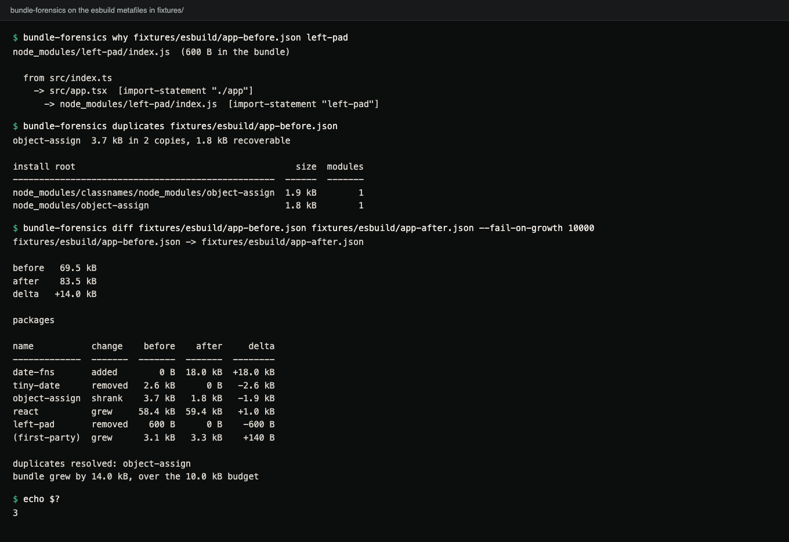
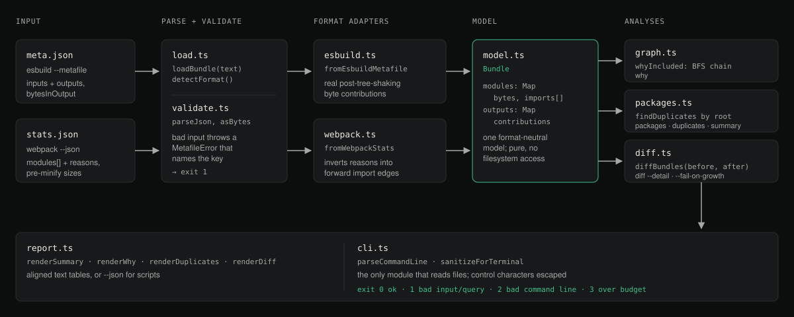

# bundle-forensics

Explain a JavaScript bundle from the stats file your bundler already
emits: which import pulled a module in, which dependency is installed
twice, and what actually changed between two builds.

## Demo



Terminal capture of a real run against the esbuild metafiles in [`fixtures/esbuild/`](fixtures/esbuild):
`why`, `duplicates`, and a `diff` with a 10 kB growth budget that fails with exit code 3.

<details>
<summary>Same output as text</summary>

```console
$ bundle-forensics why fixtures/esbuild/app-before.json left-pad
node_modules/left-pad/index.js  (600 B in the bundle)

  from src/index.ts
    -> src/app.tsx  [import-statement "./app"]
      -> node_modules/left-pad/index.js  [import-statement "left-pad"]

$ bundle-forensics duplicates fixtures/esbuild/app-before.json
object-assign  3.7 kB in 2 copies, 1.8 kB recoverable

install root                                          size  modules
--------------------------------------------------  ------  -------
node_modules/classnames/node_modules/object-assign  1.9 kB        1
node_modules/object-assign                          1.8 kB        1

$ bundle-forensics diff fixtures/esbuild/app-before.json fixtures/esbuild/app-after.json --fail-on-growth 10000
fixtures/esbuild/app-before.json -> fixtures/esbuild/app-after.json

before   69.5 kB
after    83.5 kB
delta   +14.0 kB

packages

name           change    before    after     delta
-------------  -------  -------  -------  --------
date-fns       added        0 B  18.0 kB  +18.0 kB
tiny-date      removed   2.6 kB      0 B   -2.6 kB
object-assign  shrank    3.7 kB   1.8 kB   -1.9 kB
react          grew     58.4 kB  59.4 kB   +1.0 kB
left-pad       removed    600 B      0 B    -600 B
(first-party)  grew      3.1 kB   3.3 kB    +140 B

duplicates resolved: object-assign
bundle grew by 14.0 kB, over the 10.0 kB budget

$ echo $?
3
```

</details>

## Requirements

- Node.js 20 or newer (`engines`). CI runs Node 20, 22 and 24 on Linux,
  Windows and macOS.
- A stats file from your own build: esbuild (`--metafile`) or webpack
  (`--json`). bundle-forensics does not run a bundler itself.

## Install

bundle-forensics is **not published to the npm registry** (nothing is
published under that name). Install it from a clone:

```bash
git clone https://github.com/hellpuffyt/bundle-forensics
cd bundle-forensics
npm ci && npm run build
npm link            # puts `bundle-forensics` on your PATH
```

Without `npm link`, run `node bin/bundle-forensics.js` from the clone.

## Quick start

Try it on the metafile committed in this repository:

```
$ bundle-forensics summary fixtures/esbuild/app-before.json
fixtures/esbuild/app-before.json

stats format                 esbuild
outputs                            2
modules                           12
packages                           5
duplicated packages                1
total size                   69.5 kB
first-party            3.1 kB (4.5%)
dependencies         66.3 kB (95.5%)

outputs

output             size  modules  entry point
--------------  -------  -------  -------------
dist/app.js     67.7 kB       11  src/index.ts
dist/worker.js   1.8 kB        3  src/worker.ts
```

On your own project:

```bash
esbuild src/index.ts --bundle --minify --outdir=dist --metafile=meta.json
bundle-forensics duplicates meta.json
bundle-forensics why meta.json left-pad
bundle-forensics diff main.json branch.json --fail-on-growth 10000
```

Zero runtime dependencies, `node:` builtins only.

## What it answers

A treemap shows that `react-dom` is 130 kB. These three questions are
harder, and the metafile already holds the answers:

**"Why is this here at all?"** Something imported it, transitively, from
an entry point. That is a shortest path in a graph the bundler wrote
down, so it can be printed:

```
$ bundle-forensics why meta.json left-pad
node_modules/left-pad/index.js  (600 B in the bundle)

  from src/index.ts
    -> src/app.tsx  [import-statement "./app"]
      -> node_modules/left-pad/index.js  [import-statement "left-pad"]
```

The search is breadth-first, so the chain you get is the *shortest* one.
A depth-first walk can report a twelve-hop route through a barrel file
when a two-hop one exists.

**"Am I shipping this twice?"** A resolved path records its own install
location: `node_modules/classnames/node_modules/object-assign/index.js`
is a private second copy of a package that also lives at the top level.
No lockfile, registry or network access is needed; the path is the evidence:

```
$ bundle-forensics duplicates meta.json
object-assign  3.7 kB in 2 copies, 1.8 kB recoverable

install root                                          size  modules
--------------------------------------------------  ------  -------
node_modules/classnames/node_modules/object-assign  1.9 kB        1
node_modules/object-assign                          1.8 kB        1
```

"Recoverable" is a lower bound, and deliberately so: collapsing the
copies can only ever remove the smaller ones, and only if the versions
are compatible.

**"What did this PR cost?"** Not a total, which is unactionable, but a
per-package ledger:

```
$ bundle-forensics diff main.json branch.json
main.json -> branch.json

before   69.5 kB
after    83.5 kB
delta   +14.0 kB

packages

name           change    before    after     delta
-------------  -------  -------  -------  --------
date-fns       added        0 B  18.0 kB  +18.0 kB
tiny-date      removed   2.6 kB      0 B   -2.6 kB
object-assign  shrank    3.7 kB   1.8 kB   -1.9 kB
react          grew     58.4 kB  59.4 kB   +1.0 kB
left-pad       removed    600 B      0 B    -600 B
(first-party)  grew      3.1 kB   3.3 kB    +140 B

duplicates resolved: object-assign
```

Every output above is real: it is the tool run against
[`fixtures/esbuild/`](fixtures/esbuild) (`app-before.json` as `main.json`,
`app-after.json` as `branch.json`), and the `duplicates` block is asserted
byte for byte by the `dogfood` job in CI.

## The number it reports

A module has two sizes and they are not the same number:

- its **source size**, how big the file was on disk;
- its **contribution**, how many bytes of an emitted file came from it,
  after tree shaking and minification.

Only the second one answers "why is my bundle this big", so it is what
every command reports. In the fixture above `react.production.min.js`
is 60,000 bytes of source and contributes 58,000. A module that is
imported but fully tree-shaken contributes nothing at all.

## Source layout



*Diagram (not a screenshot) of the source modules in `src/` and how a stats file flows through them.*

## Commands

| Command | Answers |
| --- | --- |
| `summary <stats>` | how big, how much of it is yours, how much is duplicated |
| `packages <stats>` | every npm package, biggest first, duplicates flagged |
| `duplicates <stats>` | packages shipped from more than one install root |
| `modules <stats>` | every module, biggest first |
| `why <stats> <module>` | shortest import chain from each entry point |
| `diff <before> <after>` | what changed, by package, module or output |

Options: `--output <file>` restricts everything to one emitted chunk,
`--top <n>` limits rows (`0` means all), `--detail packages|modules|outputs`
picks the diff granularity, `--json` prints machine-readable output, and
`--fail-on-growth <bytes>` makes `diff` exit 3 over budget.

`<module>` is resolved leniently, in this order: an exact path, a package
name (`react` expands to every file of react), a path suffix
(`util/log.ts`), then a substring. Each step is tried only if the previous
found nothing, so `react` cannot quietly drag in `react-dom`.

## In CI

Exit codes are a contract: `0` success, `1` bad input or bad query, `2`
bad command line, `3` over the size budget.

```yaml
- run: npx esbuild src/index.ts --bundle --minify --outdir=dist --metafile=after.json
- run: git clone --depth 1 https://github.com/hellpuffyt/bundle-forensics "$RUNNER_TEMP/bf"
- run: cd "$RUNNER_TEMP/bf" && npm ci && npm run build
- run: node "$RUNNER_TEMP/bf/bin/bundle-forensics.js" diff before.json after.json --fail-on-growth 10000
```

That fails the build on a 10 kB regression *and* prints which package
caused it, in the same output (over budget it also prints
`bundle grew by 14.0 kB, over the 10.0 kB budget` for the fixture pair).
Producing `before.json` from the base branch is up to your workflow.

`--output <file>` must name an output that exists in at least one of the
two builds; a typo (or a content-hashed name that changed) is an error,
not a silent `0 B` diff that passes the budget.

## Supported stats files

The format is detected from the file; you never pass a flag.

**esbuild metafiles** (`esbuild --metafile=meta.json`) are the primary
target, because they are the only common format that records the real
post-tree-shaking byte contribution of each module to each output.

**webpack stats** (`webpack --json > stats.json`) work too, with two
caveats that change what the numbers mean:

- **Sizes are pre-minification.** webpack reports a module's parsed
  source size; there is no per-asset equivalent of `bytesInOutput`, so
  contribution is recorded as source size. Rankings and duplicate
  detection stay correct; the totals will not match the file on disk.
- **Concatenated modules are not unpacked.** Scope hoisting collapses
  several files into one stats module, which is reported under its own
  name.

webpack records the graph backwards (each module lists its `reasons`),
so the loader inverts it into forward edges; `why` works the same way on
both.

## Malformed input

Stats files arrive from CI artefacts and colleagues, so being handed the
wrong file is the common case. Every rejection names the key:

```
$ bundle-forensics summary package.json
bundle-forensics: package.json is not a recognised bundle stats file: expected an esbuild metafile (top-level "inputs" and "outputs") or webpack stats (a top-level "modules" array)

$ bundle-forensics summary broken.json
bundle-forensics: inputs["src/index.ts"].bytes must be a non-negative number, found a string
```

Unknown import kinds and unfamiliar keys are tolerated rather than
rejected. esbuild adds vocabulary in minor releases, and a stats reader
that broke on a bundler upgrade would fail for reasons unrelated to your
bundle.

## As a library

Everything the CLI does is exported, so a CI script can compute a number
and decide for itself.

```ts
import { readFile } from "node:fs/promises";
import { findDuplicates, loadBundle, whyIncluded } from "bundle-forensics";

const bundle = loadBundle(await readFile("meta.json", "utf8"), "meta.json");

for (const duplicate of findDuplicates(bundle)) {
  console.log(`${duplicate.name}: ${duplicate.wastedBytes} B recoverable`);
  for (const copy of duplicate.copies) console.log(`  ${copy.root}`);
}

const [chain] = whyIncluded(bundle, "node_modules/left-pad/index.js");
console.log(chain?.links.map((link) => link.to));
```

The analysis core is pure: `loadBundle` takes a string, and no function
in `src/` other than the CLI touches the filesystem. That is why the test
suite runs against committed fixture metafiles and never invokes a
bundler.

## Limitations

- Only esbuild metafiles and webpack stats JSON are read. Other bundlers'
  stats formats (Rollup, Vite, Parcel) are not supported.
- webpack numbers are pre-minification and concatenated modules are not
  unpacked (see above).
- Duplicate detection reads install paths only; it does not know package
  versions, so "recoverable" assumes the copies could be deduplicated.
- Not published to npm.

## Development

```bash
npm install
npm run typecheck   # tsc --noEmit, strict
npm run lint        # eslint, type-aware
npm test            # vitest
npm run coverage    # fails below 95%
```

347 tests across eleven files, all driven by the metafiles in `fixtures/`
(plus a few written to a temp directory at runtime). Coverage is 99.7% of
statements, 99.8% of lines, 99.3% of functions and 96.8% of branches
(`npm run coverage`, vitest 4, Node 24, macOS).

See [CONTRIBUTING.md](CONTRIBUTING.md) before opening a pull request.

## Security

Stats files are treated as untrusted input: they are only parsed as JSON
and validated structurally (every rejection names the key), nothing in them
is executed or fetched, and every control character from them is escaped
before it reaches your terminal (so a crafted module name cannot rewrite
the output or emit terminal escape sequences). Please report
vulnerabilities privately as described in [SECURITY.md](SECURITY.md).

## License

MIT. See [LICENSE](LICENSE).
